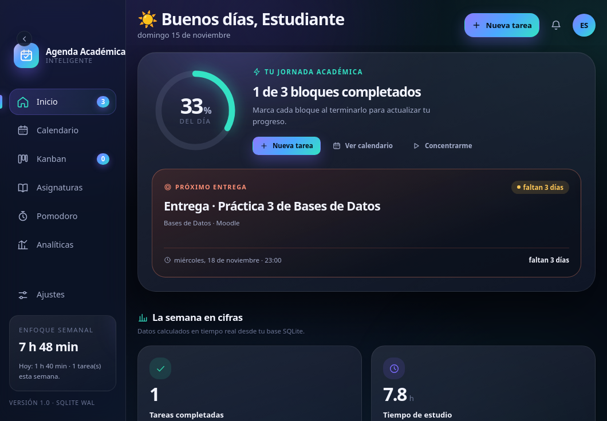
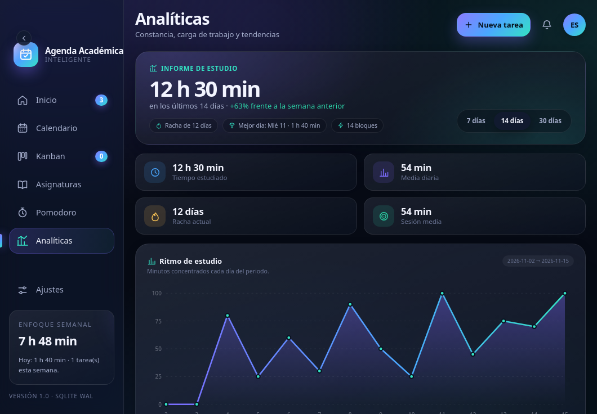
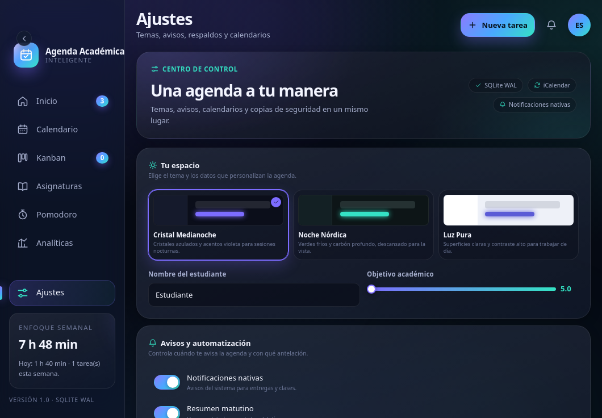

# 🎓 Agenda Académica Inteligente

Aplicación de escritorio **visualmente espectacular** para organizar la vida
académica de un estudiante de Ingeniería Informática. Reúne calendario,
tablero Kanban de prácticas, calculadora de notas, Pomodoro, analíticas y un
**gadget flotante transparente** que muestra tu «Plan de Hoy» sobre el
escritorio, con notificaciones nativas del sistema operativo.

<!-- Captura de la vista de inicio -->


## ✨ Características

| Módulo | Qué ofrece |
| --- | --- |
| 🏠 **Inicio** | Tarjetas KPI animadas, próximos exámenes, línea de tiempo del día y acciones rápidas. |
| 🗓️ **Calendario** | Cuadrícula semanal/mensual con eventos por asignatura, «línea de ahora», detección de solapamientos y *drag & drop*. |
| 📋 **Kanban** | Cuatro columnas (*Pendiente*, *En Desarrollo*, *Revisión*, *Entregado*), prioridades, subtareas y progreso. |
| 📚 **Asignaturas** | Tarjetas con color, profesor, aula y enlaces; calculadora que indica **qué nota necesitas** para aprobar o llegar a notable/sobresaliente. |
| ⏱️ **Estudio Focus** | Pomodoro circular SVG animado, modos 25/5, 50/10 y personalizado, sesiones persistidas. |
| 📊 **Analíticas** | Serie diaria, reparto por asignatura, mapa de calor de 8 semanas, franjas horarias y periodos de 7/14/30 días. |
| 🪟 **Gadget** | Ventana sin bordes, translúcida y anclada al escritorio, con opacidad en vivo, bloqueo y vista compacta. |
| 🔔 **Notificaciones** | Avisos nativos configurables (1 día, 2 horas, 15 minutos), resumen matutino y campana con historial. |
| 🔄 **Calendarios** | Importación/suscripción `.ics` (Moodle, Google, Outlook) con deduplicación por `UID`. |
| ⚙️ **Ajustes** | 3 temas CSS, preferencias de avisos, feeds iCalendar, respaldos `.zip`, arranque automático e informe académico Markdown. |

## 🧱 Arquitectura en 30 segundos

```
┌───────────────────────────── QWebChannel (JSON) ─────────────────────────────┐
│                                                                              │
│  HTML5 + CSS3 + JS  ◄──────►  ApiPuente (Python)  ◄──►  Servicios y repositorios
│  (Chromium embebido)                │                                    │
│  · index.html (7 vistas)            │                              SQLite WAL
│  · gadget.html (transparente)       ▼                                    │
│  · 3 temas + animaciones      Planificador de notificaciones       (un archivo)
│                              Bandeja del sistema · Inicio automático
└──────────────────────────────────────────────────────────────────────────────┘
```

**¿Por qué esta arquitectura y no JavaFX o widgets clásicos?** Porque permite
usar **CSS3 puro** (variables, `backdrop-filter: blur()`, gradientes, Grid,
Flexbox, sombras multicapa, `transition` y `@keyframes` a 60 fps) y a la vez
mantener un backend nativo ligero en Python para la bandeja del sistema, las
notificaciones del SO, SQLite en modo WAL y ventanas sin bordes ancladas al
escritorio. JavaFX obliga a una JVM y a su propio lenguaje de estilos; los
widgets clásicos de Qt no alcanzan este nivel de acabado sin cientos de líneas
imperativas. El motor Chromium viene incluido en PySide6, funciona **offline** y
no necesita servidor local. Detalle completo en
[`docs/arquitectura.md`](docs/arquitectura.md).

## 🚀 Instalación en 3 pasos

```bash
# 1. Crear el entorno virtual e instalar dependencias
python -m venv .venv && source .venv/bin/activate
pip install -r requirements.txt

# 2. Arrancar la aplicación (crea y migra la base de datos automáticamente)
python main.py
```

**3.** Listo. Al cerrar la ventana principal, la agenda sigue viva en la bandeja
del sistema. En Linux, si el motor web no arranca en un contenedor, ejecuta
`QTWEBENGINE_CHROMIUM_FLAGS="--no-sandbox" python main.py`.

> Requisitos: **Python 3.11+**, entorno gráfico y ~500 MB de disco (PySide6).
> Probado en Linux, Windows 11 y macOS.

## 🖱️ Interacción 100 % con ratón

No hay atajos de teclado: la navegación usa la barra lateral, los formularios se
abren con modales animados, las tarjetas se arrastran, los selectores de tema
son visuales y las acciones destructivas piden una segunda pulsación de
confirmación. El
gadget se mueve arrastrando su cabecera y sus controles aparecen al pasar el
ratón.

## 🗂️ Estructura del código

```
agenda/
├── main.py                    # Punto de entrada
├── src/
│   ├── configuracion.py       # Rutas, configuración por defecto y paleta
│   ├── base_datos/            # SQLite WAL, migraciones y repositorios
│   ├── servicios/             # Notificaciones, ICS, Pomodoro, notas, analíticas…
│   ├── puente/                # API QWebChannel expuesta a JavaScript
│   ├── ventanas/              # Ventana principal, gadget, bandeja y orquestador
│   └── interfaz/
│       ├── index.html         # Aplicación principal (SPA de 7 vistas)
│       ├── gadget.html        # Gadget «Plan de Hoy»
│       └── recursos/
│           ├── css/           # variables · temas · animaciones · componentes · gadget
│           ├── js/            # puente, utilidades y un módulo por vista
│           └── img/           # Iconografía SVG vectorial
├── pruebas/                   # Suite pytest (sin Qt ni red)
├── docs/                      # Arquitectura, diagramas Mermaid y capturas
└── requirements.txt
```

## 🧪 Datos de demostración

El primer arranque crea un curso ficticio (asignaturas, clases, entregas,
evaluaciones y sesiones de estudio) para que el calendario y las analíticas no
estén vacíos. Solo ocurre **al crear la base de datos por primera vez**: si
borras una asignatura —o todas— seguirán borradas después de reiniciar, y sus
clases, tareas y notas se eliminan con ella.

## ✅ Pruebas

```bash
pytest
```

La suite (51 pruebas) cubre repositorios y concurrencia SQLite, el sembrado
inicial, el sincronizador `.ics`, la calculadora de notas, las analíticas, el
generador de informes, el planificador de notificaciones y los respaldos.

## 📸 La interfaz en imágenes

| Analíticas | Ajustes |
| --- | --- |
|  |  |

## 📄 Documentación

- [Arquitectura híbrida y modelo ER](docs/arquitectura.md)
- [Diagramas de casos de uso, flujo y secuencia](docs/diagramas.md)
- [Capturas de la interfaz](docs/capturas/)

## 🧑‍💻 Autor

Proyecto desarrollado por **Álvaro** — Ingeniería Informática.
