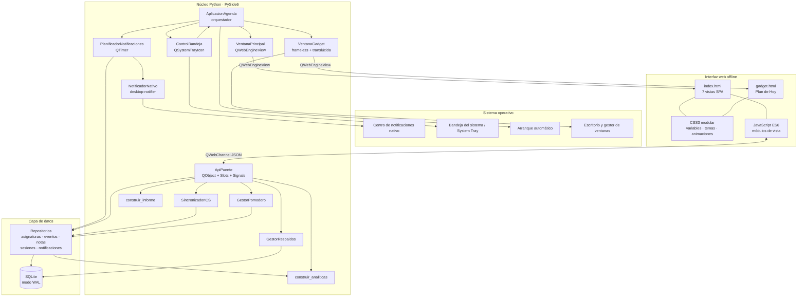
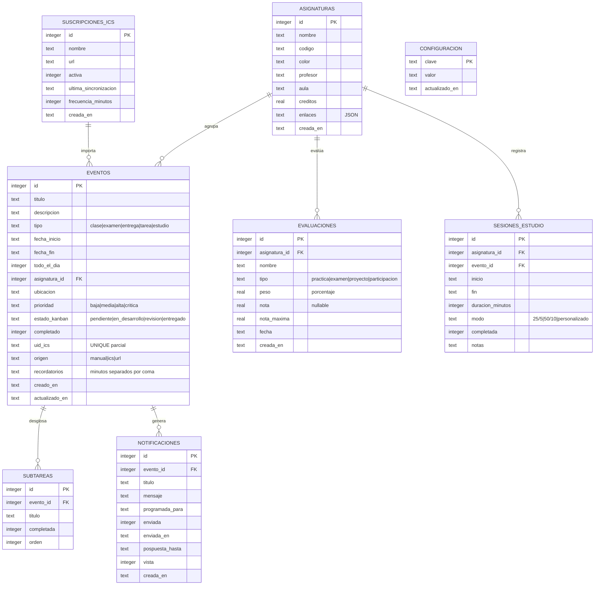
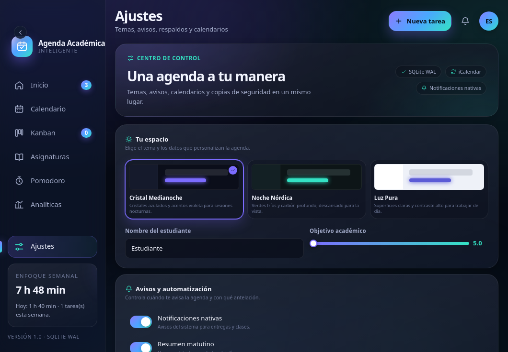
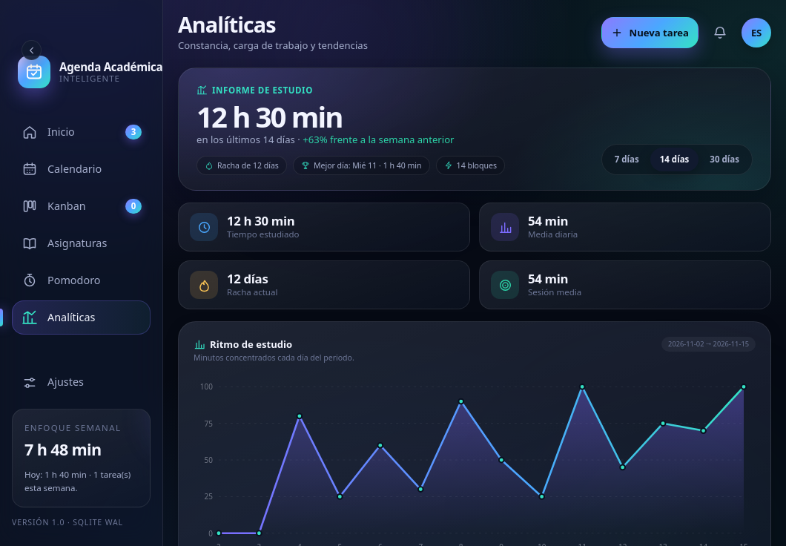

# Arquitectura de la Agenda Académica Inteligente

> Documento técnico de referencia. Explica las decisiones de diseño, la
> separación de capas, el modelo de datos y el flujo de información entre el
> backend nativo en Python y la interfaz declarativa en HTML5/CSS3/JavaScript.

---

## 1. Visión general

La aplicación sigue una **arquitectura híbrida de escritorio**: un núcleo
nativo en Python (PySide6) que controla ventanas, bandeja del sistema,
notificaciones del sistema operativo y persistencia; y una **capa de
presentación web** renderizada offline por `QWebEngineView` (Chromium). Ambas
capas se comunican de forma bidireccional mediante `QWebChannel`, que serializa
las llamadas a métodos Python como mensajes JSON asíncronos.



### Flujo de una interacción típica

1. El usuario pulsa una tarjeta en la vista HTML. El módulo JavaScript
   correspondiente llama a `window.puente.<metodo>(...)`.
2. `QWebChannel` serializa los argumentos y ejecuta la ranura Python en el hilo
   de la interfaz.
3. La ranura delega en el servicio o repositorio adecuado.
4. El repositorio escribe en SQLite (WAL) y devuelve el estado actualizado.
5. La ranura responde a JavaScript con JSON y emite la señal
   `datosActualizados`, que refresca todas las vistas abiertas y el gadget.

---

## 2. Justificación tecnológica

### ¿Por qué HTML5 + CSS3 dentro de `QWebEngineView` y no JavaFX o widgets clásicos?

| Criterio | Widgets Qt (`QWidget`) | JavaFX | **PySide6 + QWebEngineView (elegido)** |
| --- | --- | --- | --- |
| Acabado visual | Limitado a estilos por widget | CSS propio limitado | **CSS3 completo: variables, Grid, Flexbox, `backdrop-filter`, gradientes multicapa** |
| Animaciones | `QPropertyAnimation` manual | Timeline | **`transition` y `@keyframes` aceleradas por GPU a 60 fps** |
| Temas en vivo | Reconstrucción de paletas | Reaplicar CSS | **Cambio de atributo `data-tema`: transición suave sin recargar** |
| Gadget translúcido | Difícil de estilizar | Complejo | **HTML transparente con glassmorphism real** |
| Integración con el SO | Nativa | JVM + puente | **Nativa: bandeja, notificaciones, ventanas sin bordes, WAL** |
| Curva de mantenimiento | Alta (mucho código imperativo) | Media | **Baja: UI declarativa separada del dominio Python** |

La combinación elegida evita las dos alternativas peores: renunciar al diseño
moderno (widgets clásicos) o arrastrar una máquina virtual Java (JavaFX). El
motor Chromium se distribuye con PySide6, funciona **totalmente offline** y no
necesita servidor: los recursos se cargan con `file://` y la comunicación usa
`QWebChannel` sobre el mismo proceso.

### ¿Por qué SQLite en modo WAL?

- **Lecturas concurrentes**: el gadget puede leer mientras la ventana principal
  escribe. WAL permite múltiples lectores y un escritor simultáneo.
- **Durabilidad razonable** con `synchronous=NORMAL` y transacciones cortas.
- **Cero administración**: un único archivo portable, fácil de respaldar con la
  API de copia en línea de SQLite (`Connection.backup`).
- **Integridad referencial** activada con `PRAGMA foreign_keys=ON`.

### ¿Por qué un solo proceso y no un servidor local?

Un servidor HTTP añadiría puertos, autenticación, latencia y superficie de
ataque. `QWebChannel` ofrece RPC tipado sobre memoria compartida del mismo
proceso y mantiene la aplicación como un único ejecutable de escritorio.

---

## 3. Organización del código

```
agenda/
├── main.py                     # Punto de entrada (arranque de Qt)
├── src/
│   ├── configuracion.py        # Rutas, valores por defecto y paleta
│   ├── base_datos/
│   │   ├── conexion.py         # GestorBaseDatos: WAL, migraciones, transacciones
│   │   ├── esquema.py          # DDL versionado del esquema
│   │   └── repositorios/       # Un repositorio por agregado
│   ├── servicios/              # Reglas de negocio puras (testeables sin Qt)
│   ├── puente/api_web.py       # Ranuras y señales expuestas a JavaScript
│   ├── ventanas/               # Ventana principal, gadget, bandeja, orquestador
│   └── interfaz/               # HTML, CSS modular, JS y SVG
├── pruebas/                    # pytest: repositorios, ICS, notas, analíticas, avisos, respaldos
└── docs/                       # Arquitectura y diagramas Mermaid
```

Reglas de dependencia:

- `servicios` y `base_datos` **no importan Qt**; son probables en consola.
- `puente` es la única capa que conoce a la vez Qt y los servicios.
- `interfaz` no conoce Python: solo habla con el objeto `puente`.
- `ventanas` compone todo y nunca contiene SQL.

---

## 4. Modelo de datos (diagrama entidad-relación)



### Decisiones del modelo

- **Fechas en ISO-8601** (`YYYY-MM-DDTHH:MM`) para que SQLite ordene
  lexicográficamente y JavaScript las parsee sin conversiones frágiles.
- **`eventos` unifica** clases, exámenes, entregas y tarjetas Kanban. El campo
  `estado_kanban` solo se usa cuando `tipo='tarea'`; así el calendario y el
  tablero comparten una única fuente de verdad.
- **`uid_ics` único parcial** (`WHERE uid_ics IS NOT NULL`): evita duplicados al
  resincronizar sin impedir muchos eventos manuales con `uid_ics` nulo.
- **`subtareas`** separada para permitir reordenación y progreso calculado.
- **Borrado de una asignatura**: el repositorio elimina en la misma transacción
  sus evaluaciones y todos sus eventos (clases, exámenes, entregas y tareas),
  de modo que no quedan tarjetas huérfanas en el calendario ni en el Kanban.
  Las sesiones de estudio sí se conservan con `asignatura_id` nulo para que el
  histórico de analíticas no cambie.
- **`notificaciones`** es un historial y a la vez una cola: `programada_para`
  permite posponer y `vista` alimenta la campana de la interfaz.
- **`configuracion`** clave-valor evita migraciones por cada preferencia nueva.

---

## 5. Concurrencia y consistencia

- Cada hilo abre su **propia conexión** (SQLite no comparte conexiones entre
  hilos); el gestor usa `check_same_thread=False` solo para el patrón de
  conexión por hilo con bloqueo de escritura.
- Las escrituras se serializan con un `threading.RLock` de proceso y
  transacciones `BEGIN IMMEDIATE`.
- Los repositorios usan `row_factory = sqlite3.Row` y devuelven diccionarios.
- El planificador de notificaciones corre en el hilo Qt mediante `QTimer`
  (sin bloqueos) y las operaciones de red (`.ics`) se ejecutan con timeout y
  se guardan de forma atómica.
- La copia de seguridad usa la API `backup()` de SQLite, que produce una
  instantánea coherente incluso con WAL activo.

---

## 6. Seguridad y robustez

- Consultas siempre **parametrizadas** (`?`) para evitar inyección SQL.
- Validación de entrada en servicios (pesos 0-100, fechas ISO, URLs `http(s)`).
- Los recursos web se cargan desde disco con `QUrl.fromLocalFile`; no se acepta
  navegación externa en el `QWebEngineView`.
- Los enlaces externos de asignaturas se abren con `QDesktopServices` solo si
  usan esquemas `http`, `https` o `mailto`.
- Los respaldos se validan (cabecera SQLite y `PRAGMA integrity_check`) antes de
  restaurar y se guarda una copia de seguridad previa.

---

## 7. Ajustes, analíticas e informes

### Vista de ajustes

La vista `ajustes` es el centro de control de la aplicación y agrupa seis
paneles independientes:

1. **Tu espacio** — tarjetas visuales de los tres temas (`data-tema`), nombre del
   estudiante y objetivo académico. El cambio de tema solo modifica
   `document.documentElement.dataset.tema`; las transiciones CSS hacen el resto.
2. **Avisos y automatización** — interruptores de notificaciones, resumen
   matutino y sincronización, además de los chips de antelación
   (`avisos_predeterminados`, lista de minutos separada por comas).
3. **Calendarios iCalendar** — alta de feeds (nombre, URL y frecuencia),
   importación de archivos `.ics`, pausa, borrado y sincronización manual.
4. **Copias de seguridad** — creación de ZIP, listado con metadatos, borrado y
   restauración en dos pasos. Las rutas se validan para no salir del directorio
   de respaldos.
5. **Sistema** — arranque automático (`InicioAutomatico`), carpeta de datos y
   versión del esquema.
6. **Informe académico** — previsualización del Markdown generado y guardado en
   disco con `QFileDialog`.



### Analíticas

`src/servicios/analiticas.py` es una función pura: recibe sesiones, eventos y
asignaturas ya serializados y devuelve KPIs, serie diaria, reparto por
asignatura, franjas horarias, mapa de calor de 56 días (alineado de lunes a
domingo) y estado académico. La interfaz pinta la serie como un SVG con área
degradada y el reparto como un `conic-gradient`, sin dependencias externas.



### Informe en Markdown

`src/servicios/informes.py` combina el expediente ponderado, las analíticas y
las entregas de los próximos 14 días para producir un documento con tablas,
métricas, recomendaciones y un resumen ejecutivo. El puente expone
`generar_informe` (previsualización) y `guardar_informe` (escritura en disco);
el Markdown se renderiza en el cliente con un conversor mínimo que escapa el
texto antes de insertarlo en el DOM.
