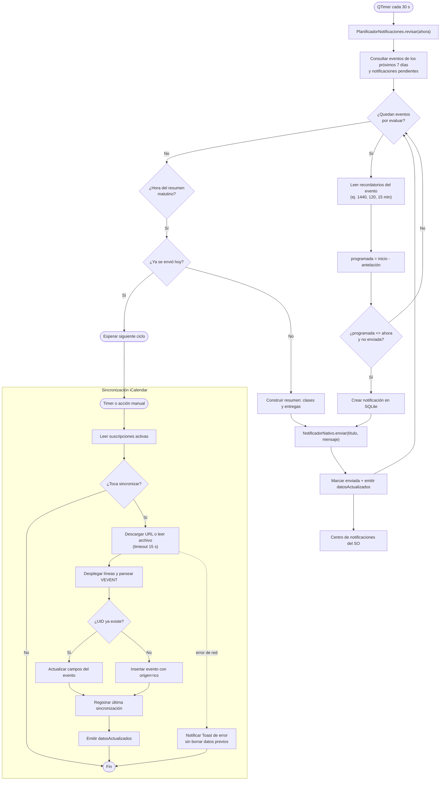
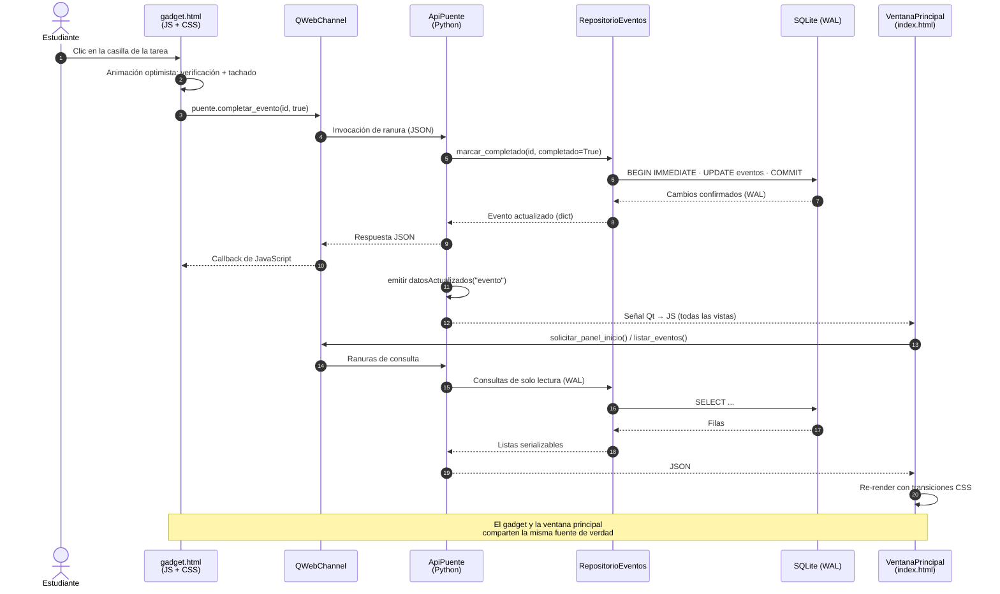
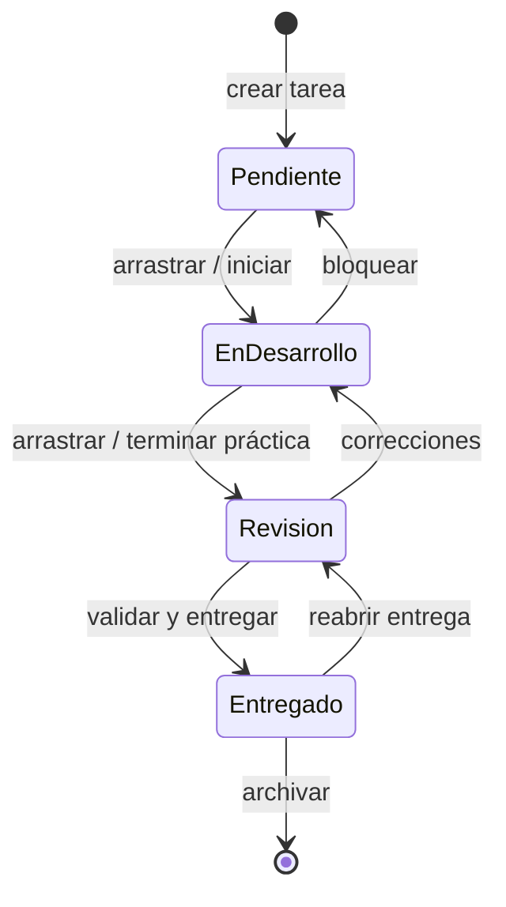

# Diagramas de comportamiento

Este documento complementa a [`arquitectura.md`](arquitectura.md) con los
diagramas de casos de uso, los flujos del motor de notificaciones y del
sincronizador iCalendar, y la secuencia completa de una interacción a través de
`QWebChannel`.

---

## 1. Casos de uso

Actores: **Estudiante** (actor principal), **Sistema operativo** (notificaciones,
bandeja, arranque) y **Servidor externo** (feed `.ics` de Moodle/Google/Outlook).

```mermaid
flowchart LR
    E(("👩‍🎓 Estudiante"))
    SO(("🖥️ Sistema<br/>operativo"))
    WEB(("☁️ Servidor<br/>ICS"))

    subgraph Agenda["Agenda Académica Inteligente"]
        CU1["Consultar panel de inicio"]
        CU2["Gestionar asignaturas"]
        CU3["Gestionar eventos y clases"]
        CU4["Arrastrar eventos en el calendario"]
        CU5["Mover tarjetas en el Kanban"]
        CU6["Gestionar subtareas"]
        CU7["Calcular nota actual y nota necesaria"]
        CU8["Registrar evaluación con peso"]
        CU9["Iniciar sesión Pomodoro"]
        CU10["Consultar analíticas"]
        CU11["Importar archivo .ics"]
        CU12["Suscribirse a URL .ics"]
        CU13["Recibir notificaciones nativas"]
        CU14["Posponer o descartar aviso"]
        CU15["Mostrar u ocultar el gadget"]
        CU16["Ajustar opacidad y posición del gadget"]
        CU17["Cambiar tema visual"]
        CU18["Exportar informe académico en Markdown"]
        CU19["Crear o restaurar respaldo"]
        CU20["Activar inicio automático"]
        CU21["Crear tarea desde la bandeja"]
        CU22["Completar tarea desde el gadget"]

        E --> CU1 & CU2 & CU3 & CU4 & CU5 & CU6 & CU7 & CU8
        E --> CU9 & CU10 & CU11 & CU12 & CU14 & CU15 & CU16
        E --> CU17 & CU18 & CU19 & CU20 & CU21 & CU22
        CU11 -.->|incluye| CU3
        CU12 -.->|incluye| CU3
        CU12 <-->|HTTP GET| WEB
        CU13 <-->|API nativa| SO
        CU20 -->|.desktop / registro| SO
        CU21 -->|menú contextual| SO
        CU16 -.->|extiende| CU15
        CU14 -.->|extiende| CU13
    end
```

### Resumen de actores y garantías

| Caso de uso | Precondición | Resultado observable |
| --- | --- | --- |
| Gestionar eventos | Asignatura existente (opcional) | Evento visible en calendario, inicio y gadget |
| Arrastrar evento | Evento en el rango visible | Nueva fecha persistida y vista refrescada |
| Calcular notas | Evaluaciones con peso | Nota media y nota necesaria por objetivo |
| Suscribirse a URL | URL `http(s)` válida | Eventos importados sin duplicados por `UID` |
| Notificar | Evento futuro con recordatorios | Aviso nativo + entrada en la campana |
| Respaldar | Base de datos abierta | ZIP con instantánea coherente verificable |

---

## 2. Flujo del motor de notificaciones y de la sincronización `.ics`

### Reglas del motor

1. **Idempotencia**: antes de enviar se comprueba la clave
   `(evento_id, programada_para)`; reiniciar la app no duplica avisos.
2. **Posponer**: `pospuesta_hasta` retrasa el envío sin perder el aviso original.
3. **Bajo consumo**: una consulta indexada cada 30 segundos; sin hilos extra.
4. **Resumen matutino**: una única notificación por día natural, después de la
   hora configurada.
5. **Sincronización segura**: si la descarga falla, se conservan los eventos
   anteriores y se informa del error con un aviso no bloqueante.

---

## 3. Secuencia `QWebChannel`: del clic en CSS/JS al gadget actualizado

Se muestra el caso «completar una tarea desde el gadget». La misma secuencia se
aplica a cualquier vista de la aplicación principal.

### Contrato del puente

- Todas las ranuras reciben y devuelven **cadenas JSON** para evitar
  incompatibilidades de tipos entre Qt y JavaScript.
- Los errores se devuelven como `{"ok": false, "error": "mensaje"}`; nunca se
  propaga una excepción Python a JavaScript.
- La señal `datosActualizados(categoria)` permite refrescos selectivos
  (`panel`, `evento`, `kanban`, `notas`, `gadget`, `configuracion`).
- La señal `notificacionRecibida(json)` alimenta la campana y los *toasts*.

---

## 4. Estados de una tarjeta Kanban

Cada transición es un `UPDATE eventos SET estado_kanban=?` validado en el
servicio; el arrastre visual solo confirma el cambio cuando SQLite lo acepta,
de modo que la interfaz nunca muestra un estado que no esté persistido.
